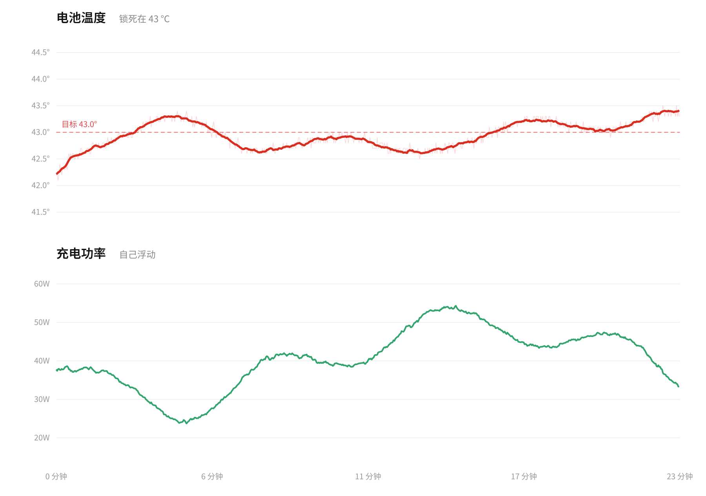
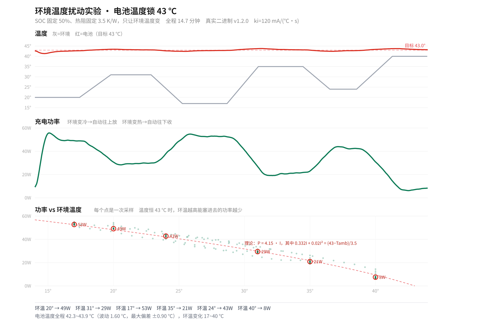
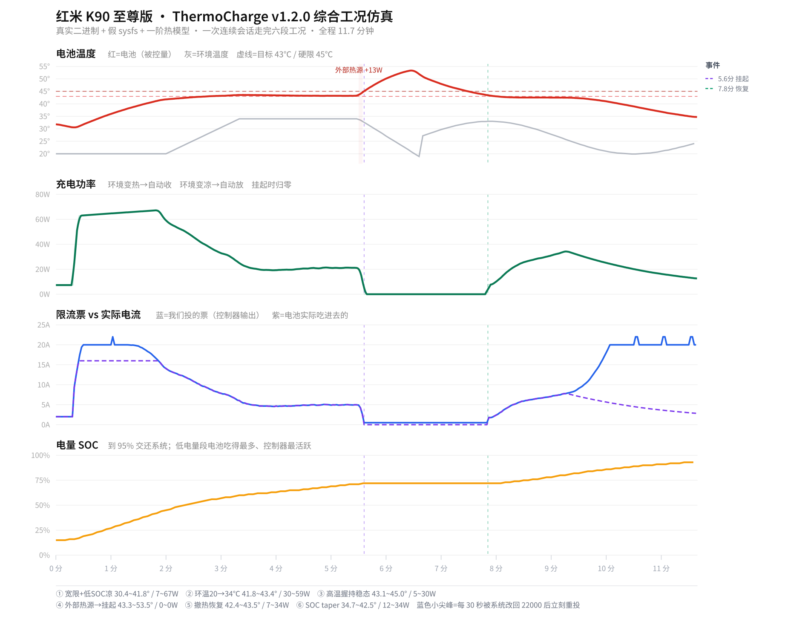
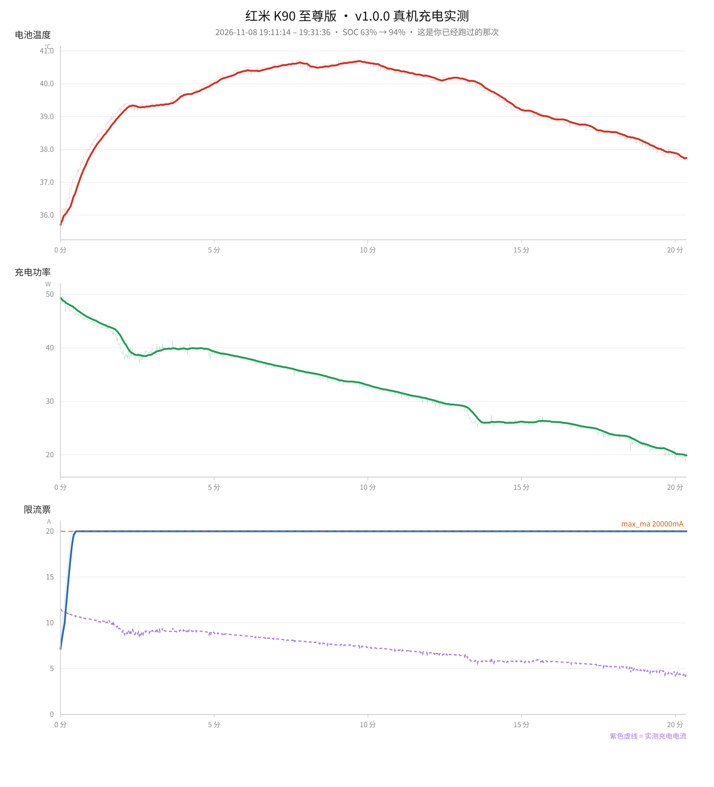

# 恒温充电 ThermoCharge

[](https://github.com/luoyi0914/ThermoCharge/releases)
[](LICENSE)


[](https://luoyi0914.github.io/ThermoCharge/)

把电池温度锁死在目标值，充电电流（功率）自己浮动。适用于 **Redmi K90 Ultra（warsaw / M332BF）**，基于 KernelSU。

> 🌐 项目主页：<https://luoyi0914.github.io/ThermoCharge/> · 📦 下载：<https://github.com/luoyi0914/ThermoCharge/releases>



> **v1.2.1**：修复版。新增抗积分风阻（限流上限最多只比实测电流高 15%）与一组**默认关闭**的
> 预测限幅 / 软着陆参数；同时修掉独立评审发现的三个缺陷（软着陆会抬流、自动环境温度估计
> 锁死稳态、NaN/inf 配置穿透）。仿真回归通过，**预测层尚未上真机**——默认关闭时行为与
> v1.2.0 一致，只多一道抗风阻。详见[实测到什么程度](#实测到什么程度)。

## 它做什么

普通快充是「能给多少给多少，热了系统再一刀切」。这个模块反过来：**温度是目标，电流是手段**。

- 电池温度低于目标 → 电流加大，功率往上跑
- 电池温度高于目标 → 电流收小，功率降下来
- 环境凉、散热好 → 自动跑出更高功率；拿在手里、塞进被窝 → 自动降下来

上图是闭环仿真示意：环境温度在 18–30 ℃ 之间缓慢摆动。快速环境扫描见下方的`环境温度扰动实验`图；
按默认 `ki=120`，环境以约 0.16 ℃/s 变化时，电池温度最大偏离目标约 0.9 ℃，功率随环境变化。

标称工况下稳态：温度 42.9 ℃，波动 0.3 ℃（等于传感器量化精度 0.1 ℃ 的 3 倍）。

## 为什么是这套控制律

充电中的电池是一个**积分型被控对象**：电流越大，温升越快。

```
dT/dt = g·I − (T − Tamb)/τ
```

对积分对象做纯积分控制 = 双积分环节 = **必然振荡**。这就是很多「性能模式」模块温度来回摆的原因。

本模块用**温度变化率阻尼**：

```
drive = −误差 − kd·(dT/dt)
dI/dt = ki·drive
```

关键设计：`kd` 的单位是**秒**（阻尼时间常数），不是传统 PID 的 Kd。

因为 `wn = √(g·ki)`、`ζ = kd·wn/2`，当 `g`（机型热参数）差一个数量级时，`ζ` 只按 `√` 变化。

实测鲁棒性（控制器参数完全不动，只改被控对象）：

| 工况 | 稳态均温 | 波动 | 超调 |
|---|---|---|---|
| 标称 | 42.88 ℃ | 0.30 ℃ | 0 |
| 热容 ×3 | 43.11 ℃ | 0.30 ℃ | +0.8 ℃ |
| 热容 ÷3 | 42.88 ℃ | 0.30 ℃ | 0 |
| 热阻 ×3（闷热） | 42.88 ℃ | 0.30 ℃ | 0 |
| 环境 35 ℃ | 42.88 ℃ | 0.30 ℃ | 0 |
| 环境 15 ℃ | 42.88 ℃ | 0.30 ℃ | 0 |
| 内阻 ×5 | 42.88 ℃ | 0.30 ℃ | 0 |

这正是「以秒为单位」的价值：换个热设计的机型，大概率不用重调。

## 安全设计

### Min 聚合：模块永远不可能比系统更激进

电流限制写进的是内核的 **votable**（投票表），不是寄存器。聚合类型是 `Min` —— 取所有投票者的最小值。

```
buck_charge_curr: batt_auth:  en=0 v=2000
buck_charge_curr: losslessRec: en=0 v=0
buck_charge_curr: user:       en=1 v=5000     ← 我们投的
effective=user type=Min v=5000
```

含义：**我们只能把电流限得更小，永远不可能超过系统自身任何一道保护。**

- 电池 > 48 ℃ 系统要停充 → 系统赢
- JEITA 判定当前不适合快充 → 系统赢
- 适配器/PMIC 过热 → 系统赢

模块不碰 `wired_thermal_remove`（默认 0），不取消任何系统温控。

### 安全判定是第一优先级

v1.2.0 把所有安全判断提到了主循环最前面。**任何一个分支都不可能绕过它**，
而且一旦降流，后面的代码只允许降得更低，不允许打回原值。

这条不是理论洁癖 —— v1.1.0 里「温度尖峰守卫」写在安全判定之后，会用
`limit_ma = P.out_ma` 整体覆盖刚算出的降流值。结果是**传感器越限的那一拍恰好是唯一不降流的一拍**。
故障注入测试里复现出来了，现在守卫改成只降不升。

- 温度 ≥ `hard_temp`（默认 45 ℃）→ **当拍**就降到 `min_ma`（不再等 4 拍）
- 继续超限 4 拍 → 投 `input_suspend=1` 在硬件输入层挂起，彻底停充
- 释放要求**回差**：温度必须掉到 `target+0.3 ℃` 以下才恢复

`input_suspend` 是 MCA 的硬件层输入挂起，聚合类型是 `Set_Or`（我们投 1 就一定挂起，
不像电流限制那样会被系统的 `Min` 压掉）。它同样必须走三 token 协议，纯数字写入会 `EINVAL`。

### 三种故障，三条独立的刹车

| 故障 | 判定 | 动作 |
|---|---|---|
| 温度读不到 | 连续 3 拍 | 降 `min_ma` + 挂起输入，日志 `sensor_fault` |
| 控制通道写不进去 | 连续 3 拍 | 挂起输入，日志 `ctl_fault` |
| 硬停充自己写失败 | 单次 | **不锁存**，下一拍继续重试 |

第二行是 v1.2.0 修的重点：控制通道坏了却以为在控温，是最危险的失效模式 ——
看起来一切正常，实际完全不受控。现在它会挂起输入、并在日志里明确报错。

「通道故障挂起」和「过温挂起」用**两个不同的标志**记录。它们解除条件完全不同：
过温看温度降下来没有，通道故障只看通道能不能写进去。共用一个标志会导致
通道坏掉之后，温度一降就被当成「可以起充了」而解挂 —— 等于解除了唯一的刹车。

### 不做的事

- 不清零别人的 `stop_handle_charge`。本进程从不写 1，也就绝不能写 0 ——
  那个 1 是系统温控/HAL/别的模块写的，抹掉它等于伪造安全状态。
- 不在未插电时写任何节点。旧版启动时就 `enforce(restore_ma)`，用我们更高的一票
  盖掉了系统更严格的 `volt_thermal_limit`（实测 3000 mA 被顶成 22000 mA）。
- 不碰 `wired_thermal_remove`（默认 0），不取消任何系统温控。

### 退出必还原

SIGTERM / 崩溃 / 卸载三条路径都会还原：

```
wired_chg_curr       → 22000000
ichg_limit           → user all 22000
input_suspend        → user all 0
wired_thermal_remove → 0
```

`wired_thermal_remove` 是否被置过，用独立的 `thermal_taken` 标志记录，
不是查当前配置值 —— 否则运行中把 `thermal_remove` 从 1 改回 0，退出时就不会还原，
系统温控会被永久摘掉。

崩溃由 `service.sh` 看门狗捕获，还原后按最近 5 分钟崩溃次数退避（2 → 8 → 20 → 45 秒）；
5 分钟内崩 5 次直接熔断停手，不再无限重启。

## 安装

1. 下载 `thermocharge-v1.2.1.zip`（当前源码含默认参数更新；重新打包后以新 SHA-256 为准）
2. KernelSU 管理器 → 模块 → 从本地安装 → 选择 zip
3. **重启**

重启后：

```sh
su -c '/data/adb/modules/thermocharge/bin/thermocharge status'
```

## 配置

配置文件：`/data/adb/thermocharge/config.conf`

改完重启，或热重载（不用重启）：

```sh
su -c '/data/adb/modules/thermocharge/bin/thermocharge set target_temp 42'
```

`set` 会改配置并给守护进程发 SIGHUP，立即生效。

### 常用项

| 项 | 默认 | 说明 |
|---|---|---|
| `target_temp` | 43.0 | 目标电池温度 ℃ |
| `hard_temp` | 45.0 | 硬上限 ℃ |
| `max_ma` | 20000 | 限流上限 mA（原厂快充 17.6 A，模块硬上限 20.5 A；20000 mA @ 4.15 V ≈ 83 W） |
| `min_ma` | 500 | 限流下限 mA |
| `ki` | 120 | 误差每 1 ℃ 每秒调整的电流量，mA/(℃·s) |
| `kd` | 40 | 阻尼时间常数（秒），大=更稳更迟钝 |
| `ctl_mode` | 1 | 0=`wired_chg_curr` 1=`mca ichg_limit` 2=两者 |
| `startup_grace_ms` | 20000 | 插电后多少毫秒开始接管，让快充握手先跑完 |
| `reassert_ms` | 5000 | 同值重投间隔 ms。系统可能把我们的票关掉 |
| `dry_run` | 0 | 1=只算不写，调试用 |

### 预测限幅与软着陆（v1.2.1 新增，全部默认关闭）

`pred_enable=0` 时这些参数完全不参与控制，行为与旧版一致。开启前需要先用开环阶跃辨识
`pred_alpha`（℃/A²）和 `pred_tau_s`（秒）——**闭环日志辨识不出来**，控制器会把温度锁在
一个点上，`T∞(I)` 不可辨识。

| 项 | 默认 | 说明 |
|---|---|---|
| `pred_enable` | 0 | 预测限幅总开关；`pred_alpha` 未辨识时自动拒绝启用并记 WARN |
| `pred_alpha` | 0 | 稳态系数，`T∞ = Tamb + α·I²`；必须实测辨识，范围 0–1 |
| `pred_tau_s` | 45 | 热时间常数 τ |
| `pred_ambient` | 0 | 环境温度；0=用残差式自动估计（精度较差，会记 WARN） |
| `pred_margin` | 0.5 | 前瞻目标 = `target + margin`，留瞬态余量 |
| `pred_horizon_s` | 60 | 前瞻时域 H |
| `pred_hit_s` | 60 | 预计撞线时间小于它时压到 `min_regulate_ma` |
| `min_regulate_ma` | 0 | 调节下限（软着陆落点）；**不要**为此抬高 `min_ma` |
| `soft_landing` | 0 | 越过 `target+soft_margin` 后把上限封在 `min_regulate_ma`，不归零 |
| `soft_margin` | 0.8 | 软着陆触发余量 ℃ |
| `soft_band` | 0.7 | 软着陆保持带宽度，超出后交回硬保护 |

三层都**只压不抬**，且都不会把电流投成 0：归零仍只由 `input_suspend` 硬保护负责。
`state` 文件会多出 `pred_enable`、`pred_cap_ma`、`amb_est` 三行，日志状态可能是
`predict` / `predict_hit` / `soft_land` / `windup`。

### 自己整定

想更快或更稳：

1. **响应太慢**（温度上不去也不降）：加大 `ki`，试 200 / 300
2. **温度来回摆**：加大 `kd`，试 60 / 80 / 120

**关于 `ki` 的默认值（120）**

本次环境温度扫描中，环温以约 0.16 ℃/s 的速度变化时，`ki=120` 的电池温度稳态最大偏差约 0.9 ℃，满足当前 ±1 ℃ 的要求。更快的环境突变会带来更大瞬态偏差；若要长期保持更窄容差，需要更高增益，但也会增加噪声和过冲风险。
### 想要更凉/更热

`target_temp` 直接改。但注意系统自己的安全边界（都从 DT 直读确认过）：

- **FFC 快充窗口是 20–48 ℃**（`ffc_temp_low=20` / `ffc_temp_high=48`），出了这个范围 `fcc=0` 直接断充
- **电池 > 48 ℃ 系统强制禁充**
- 窗口内**不会因为有 43 ℃ 就限流**：`ffc_para_cos_40_48` 的最大电流还是 17600 mA，和 23–35 ℃ 那档一样

所以 43 ℃ 在技术上完全能跑满功率。真正该考虑的是**电池寿命**：
温度每高 10 ℃，锂电老化速度大约翻倍。想长期用，`target_temp` 设 **38–40 ℃** 更划算；
43 ℃ 是「功率好看 + 老化可接受」的折中，也是默认值。

## 实测数据

```sh
su -c '/data/adb/modules/thermocharge/bin/thermocharge status'
```

曲线数据在 CSV：

```
/data/adb/thermocharge/log/curve.csv
# epoch, 温度C, 电压V, 电流A, 功率W, SOC, 限流mA, 目标温度, 状态
```

日志：

```
/data/adb/thermocharge/log/daemon.log   # 守护进程
/data/adb/thermocharge/log/supervisor.log  # 看门狗
```

画图：

```sh
awk -F, 'NR%30==0 {print $1, $2, $5}' /data/adb/thermocharge/log/curve.csv
```

## 技术细节

### 为什么不用别的节点

| 节点 | 结论 |
|---|---|
| `charge_interface/ichg_limit` | ✅ 采用。votable 投票，Min 聚合，可持续 |
| `wired_chg_curr` | ⚠️ 备用。`mi_thermald` + `micharge HAL` 会周期覆写，需高频对抗 |
| `constant_charge_current` | ❌ 0444 只读 |
| `charge_control_limit` | ❌ 0..16 档位号，被 `hypsys_vendor` 覆写 |
| `wired_chg_curr2` | ❌ 单电池包机型无效 |
| `power_limit` | ❌ 无策略实现者 |

### mca 写接口的坑

`charge_interface/*` 的写接口要求**三 token**：

```
"<标签> <类型> <数值>"
```

例如：

```sh
echo "user all 5000" > /sys/class/xm_power/charger/charge_interface/ichg_limit
```

写纯数字会失败，dmesg 明确报：

```
[mca_charge_if]mca_charge_if_sysfs_store:347 unable to parse input:5000
```

原因：反汇编 `mca_charge_if_sysfs_store` 可见 `sscanf(buf,"%s %s %s")` 返回值必须等于 3。

**单位是 mA**，不做任何换算（策略层直接 `kstrtouint`）。

合法类型（19 个）：`micharger charger buck main_buck aux_buck quick quick_main quick_aux div1 div2 div4 wl_div1 wl_div2 wl_div4 wl_buck wl_main_buck wl_aux_buck wl_quick wl_quick_main wl_quick_aux all`

### wired_chg_curr 单位陷阱

`wired_chg_curr` 是 **µA**，而 `ichg_limit` 是 **mA**。程序内部统一用 mA，写入时按通道换算。

### 回读差值优化（v1.2.0 改掉了）

v1.1.0 的 `enforce()` 先回读，值等于目标就跳过写入。想法是对的（sysfs 写入很贵，每次刷 dmesg），
但它在真机上是错的：**回读拿到的是 votable 的 effective 值，不是我们那一条票**。
只要系统有更小的票（真机实测 `volt_thermal_limit v=100`），判等永远不成立，
于是每次都写 —— 实测 **19.3 次写入/秒**，约 7 万次/小时，等于在刷日志。

v1.2.0 改成**定时重投**（`reassert_ms`，默认 5000）：不管回读是什么，每 5 秒重投一次同值票；
控制量变了则立刻重投。系统真把我们那票关掉时，最多 5 秒就能拿回来。

### 系统覆写对抗

仿真里模拟了「系统每 5 秒抢回 22000 mA」：

| 覆写周期 | 稳态均温 | 波动 |
|---|---|---|
| 30 s | 42.91 ℃ | 0.40 ℃ |
| 5 s | 43.09 ℃ | 0.40 ℃ |

两秒内拿回控制权，温度几乎不受影响。

### 单实例锁

守护进程启动时对 `daemon.lock` 取 `flock(LOCK_EX|LOCK_NB)`，拿不到就静默退出（rc=0）。

不是保险措施 —— 这是真机上真出过的事：v1.0.0 时代同时跑过两个实例，
第二个覆盖了 pid 文件，第一个退出时又 unlink 掉，导致仍在运行的那个永久失联。
更糟的是它的日志 fd 停在旧偏移量，下次写日志会从那个位置**覆盖写**，日志当场损坏。

### 测试隔离（TC_DATA）

`TC_DATA` 环境变量可以把运行数据目录（config/log/csv/state/pid/lock）整体改到别处，
默认仍是 `/data/adb/thermocharge`。仿真的 `TC_ALLOW_FAKE_SYSFS=1` 配合它使用。

没有这个隔离时踩过一个坑：仿真和故障注入测试与真机守护进程共用同一个
`daemon.log`，两边的记录交错写进同一个文件，SOC 在 44 和 53 之间来回跳 ——
看起来像控制律振荡，实际是两份无关的数据混在一起。

## 卸载

KernelSU 管理器里删除模块，或：

```sh
su -c 'touch /data/adb/modules/thermocharge/remove'
# 重启
```

`uninstall.sh` 会三重还原：`thermocharge stop` 等它优雅退出 → `restore --force` 兜底 →
按配置里的 `p_*` 路径裸写 sysfs 兜底（用户改过路径也能正确还原）。

它**不写** `charge_enable` —— 守护进程从不碰那个节点，卸载时去写它反而可能改变系统行为。

配置和日志保留在 `/data/adb/thermocharge/`，彻底清理：

```sh
su -c 'rm -rf /data/adb/thermocharge'
```

## 已知限制

- **只在插电时工作**。拔电立即交还系统。
- **SOC ≥ 95% 交还系统**（`hold_below_soc`）。这个阶段电流本来就自然衰减，没必要管。
- **不能突破 FFC 温度窗口**。DT 里 `ffc_temp_low=20`、`ffc_temp_high=48`，超出就直接 `fcc=0` 断充。
  好消息是窗口内**不靠 JEITA 限流**：`ffc_para_cos_40_48` 的最大电流仍是 17600 mA，和 23–35 ℃ 那档完全一样
  （唯一变化的是 CV 截止电流 1074→2230 mA）。所以 43 ℃ 恒温点完全有资格要 17–20 A，
  这也正是默认 `max_ma=20000` 的依据。
- **无线充电未适配**。`ctl_mode` 走的是有线通道。
- **热参数是估的**。`g` 和 `τ` 没在真机上标定过，但控制律对这种偏差不敏感（见上面的鲁棒性表）。

## 风险

改充电参数是有风险的。本模块的设计已经把风险压到很低（Min 聚合 = 只会更保守），但仍然：

- 长时间高温充电会加速电池老化，`target_temp` 别设太高
- 别在枕头上、被子里用高功率
- 出问题先 `su -c '/data/adb/modules/thermocharge/bin/thermocharge restore'`，或直接 `remove` 模块重启

### 实测到什么程度

诚实说清楚，别把仿真当实测：

- ✅ 闭环仿真跑了真实二进制（假 sysfs + 一阶热模型），标称工况 42.85 ℃ / 0.30 ℃ 波动 / 零超调
- ✅ 综合工况仿真（下面那张四联图）：六段工况连着走完，含外部热源挂起与恢复、环境骤变、SOC taper、
  每 30 秒被人抢票
- ✅ 故障注入 10 个用例全过（降流不被推翻、SOC 满仍受硬限、三种故障的刹车、单实例锁、恢复态拒写……）
- ✅ 真机跑过一次完整充电：SOC 63% → 94%，20 分钟
- ❌ **那次跑的是 v1.0.0，而且结论是「PID 根本没介入」** —— 不是控制律失效，
  是从 63% 起充、全程在恒压衰减段，热平衡点本身就低于 43 ℃，电流在 22 秒内自己撞到 20 A 上限后
  就再没动过。1191 条记录里，实测电流 ≥ 我们投的票值只占 **0.6%** 的时间，
  也就是说我们那 20 分钟投的票**从来没有成为约束**。
- ❌ v1.2.1 **同样还没做过真机充电实测**；抗风阻与预测层都只在仿真里验证过

### 环境温度扰动实验



这张图固定 SOC=50%、热阻=3.5 K/W，只改变环境温度，使用真实二进制对应的默认 `ki=120` 控制律之离散虚拟时间仿真。
计算耗时不足 1 秒（虚拟 880 秒），快于真实二进制逐秒仿真；因此它适合快速比较趋势，不代替真机热参数标定。
稳态点：环境 17 ℃→约 53 W、20 ℃→49 W、24 ℃→43 W、31 ℃→30 W、35 ℃→21 W、40 ℃→8 W。
环境变化越快，温度滞后越大；本扫描的稳态最大偏差约 ±0.9 ℃，符合当前 ±1 ℃ 的目标。

### v1.2.0 综合工况仿真



一张图里把六段情况连着走完，用的就是 `out/thermocharge` 这个真实二进制
（假 sysfs + 一阶热模型，`TC_DATA` 隔离）。

| 时间 | 工况 | 温度 | 功率 |
|---|---|---|---|
| 0~2 min | 宽限期结束 → 低电量 + 20 ℃ 凉爽 | 30.4~41.8 ℃ | 7~67 W |
| 2~3 min | 环温 20→34 ℃、热阻 3.0→4.2（握在手里） | 41.8~43.4 ℃ | 30~59 W |
| 3~5.6 min | 高温握持稳态 | 43.1~45.0 ℃ | 5~30 W |
| 5.6~7.8 min | 外部热源 +13 W（打游戏/晒到太阳） | 43.3~**53.5** ℃ | **0 W（挂起）** |
| 7.8~9.3 min | 撤掉热源 | 42.4~43.5 ℃ | 7~34 W |
| 9.3~11.7 min | 电量上来，电池自己吃不下 | 34.7~42.5 ℃ | 12~34 W |

几个值得看的点：

- **2→3 分钟那段才是这个模块的价值**：环境温度涨了 14 ℃、热阻涨了 40%，
  功率自己从 63 W 收到 20 W，温度只从 41.8 爬到 43.4 —— 基本没动。
  同样的环境变化，没有恒温控制的话温度会直接顶到系统的保护线。
- **5.6 分钟外部热源那段，温度冲到 53.5 ℃、功率归零 2.2 分钟**。
  这不是失败，是设计要的行为：外部热源灌进来的热量远超限流能抵消的量，
  唯一正确的动作就是把输入挂起。撤掉热源后温度降到 43.4 ℃ 才自动恢复。
- **第三栏的蓝色小尖峰**：每 30 秒模拟一次「系统把我们的票改回 22000 mA」，
  reassert 每次都在 5 秒内投回去，温度完全不受影响。这就是 `reassert_ms` 的意义。
- 高温稳态均值 43.33 ℃（偏目标 +0.33 ℃），是传感器量化 0.1 ℃ 的 3 倍多，
  属控制死区（0.2 ℃）的正常表现。

### v1.0.0 真机实测



上面这张是那次真机的真实数据。看第三栏就明白了：蓝线是我们投的限流票（22 秒后顶到 20 A 不再动），
紫虚线是电池实际吃的电流（一路从 11.5 A 衰减到 4.5 A）。票值全程**高于**实测电流 ——
我们投的票从来没进过场。

要看「功率上下浮动、温度锁死」的效果，得从**低 SOC（10–40%）**开始充：
那个区间电池能吃的电流远大于 20 A，热平衡点高于目标，PID 才有活干。
从 60% 以上起充，看到的就是一条单调下降的功率曲线。

## 许可

MIT
