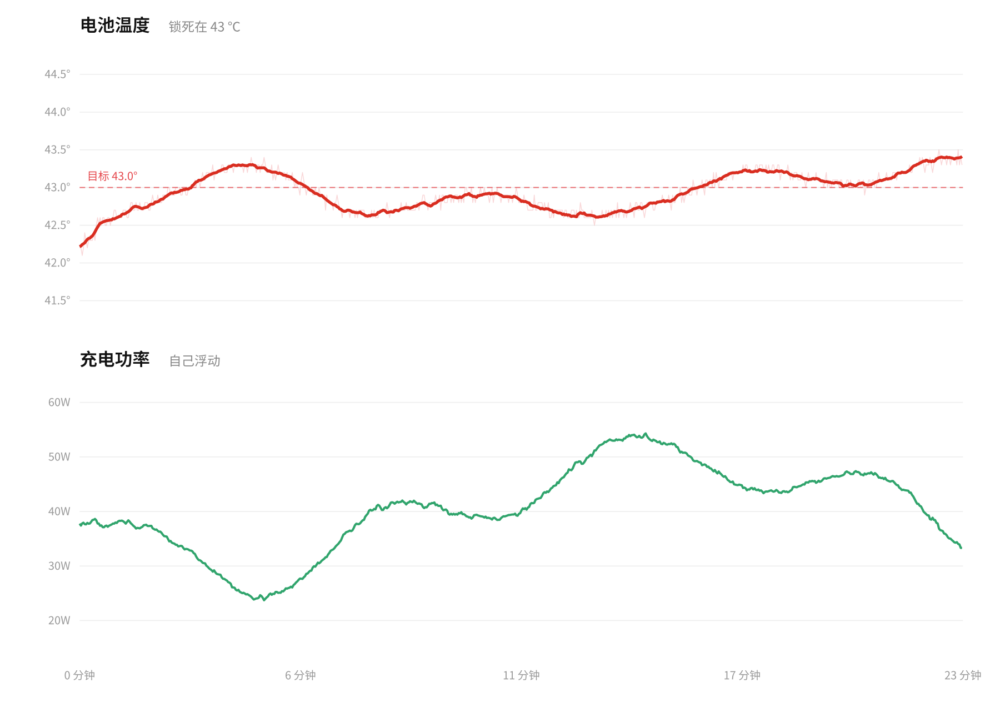
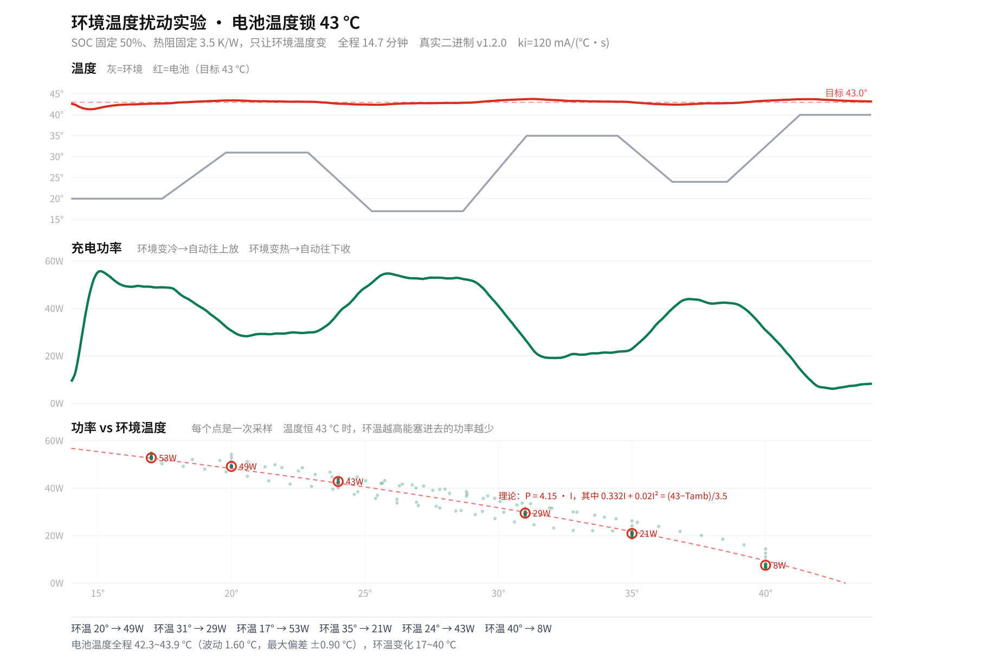
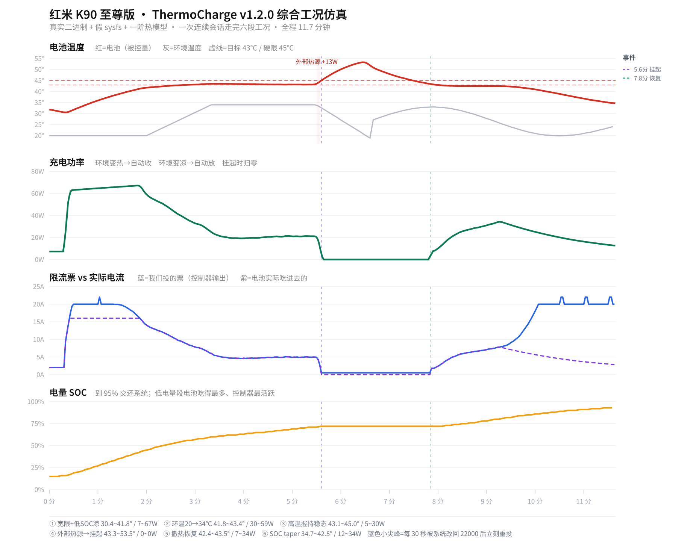
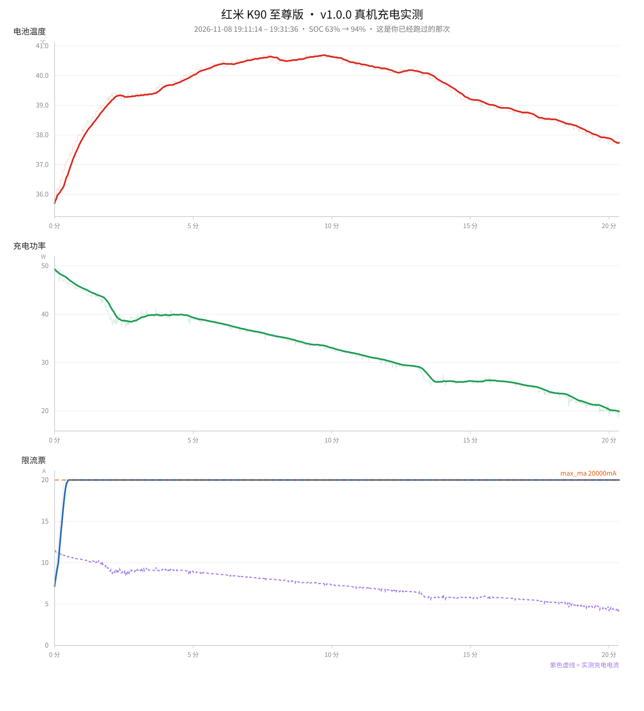

# 恒温充电 ThermoCharge

[](https://github.com/luoyi0914/ThermoCharge/releases)
[](LICENSE)


[](https://luoyi0914.github.io/ThermoCharge/)

根据**电池温度及其变化趋势**连续调整充电功率，通过电流上限票执行。主要面向 **Redmi K90 Ultra（warsaw / M332BF）** 的有线充电路径。

> 🌐 项目主页：<https://luoyi0914.github.io/ThermoCharge/> · 📦 下载：<https://github.com/luoyi0914/ThermoCharge/releases>
>
> **v1.5.0 重要提醒：**用户本次测试中，实际电池温度可能比设定目标低约 **2℃**。温差不是固定偏差，会随散热、SOC、充电器和系统策略变化；不要为补偿温差而提高硬温上限或关闭系统保护。
>
> 本版基于 v1.4.2 测试反馈，采用单一电池温度趋势控制。已有用户的有限真机反馈不能代表所有设备均已验证；请留意实际电流、充电状态及温度。



> 上图和文末旧版本记录仅作历史资料，不证明当前趋势控制器的效果。

## 它做什么

**温度是目标，电流是手段，功率不是追踪设定值。**

- 温度有余量、温升平缓且实测电流跟上上一笔票 → 连续增加允许功率，前段按温度余量加快。
- 电流暂未跟票时，低温且趋势、电压满足条件 → 允许有限回升；不把实测功率强行追到某个目标。
- 当前温度超出目标，或短期温度趋势预计越线 → 连续降低允许功率；接近稳定时逐渐收力。
- 不读取环境温度，不估计散热系数；散热变化只能通过电池温度及温变率反映。

没有几个预定瓦数档，也没有固定 0.8 W 试探步长。实际功率仍取决于系统策略、SOC、电压、充电器及限流票是否真正生效。

## 单一温度趋势控制

控制器对电池温度和斜率分别滤波，观察满 12 秒后才允许升功率。短期前瞻为：

```
预计温度 = 平滑电池温度 + (滤波延迟补偿 + 25 秒) × 平滑温变率
功率变化 = 由温度余量／越线程度决定的变化率（W/s）× 控制间隔
电流票 = 允许功率 ÷ 电池电压
```

25 秒是线性前瞻时域，**不是等待 25 秒再切一档**。变化率随温度和趋势连续变化，并受 `slew_ma_s`、电流边界及可选 `power_max_w` 上限约束；硬温和故障保护优先于日常调节。

电压异常时禁止升流；温度突跳会重置趋势观察。`state` 用 `controller=trend` 标明控制器，输出 `temp_rate_c_min`（℃/分）和 `temp_pred_25s`（℃）；这些是电池趋势估算，不是环境模型。

**精度边界**：滤波和短期外推不能保证温度锁死，也不能消除外部热源或执行通道不服从的风险。用户本次观察到实际温度可能比目标低约 2℃，这不是所有工况的固定误差。

## 安全设计

### 限流投票不等于实际控制权

MCA 电流限制参与内核 **votable**（投票表）聚合；在正确的 `Min` 路径中取各有效票的最小值。但节点写入成功不代表电荷泵实际服从，必须对照实测电流。

```
buck_charge_curr: batt_auth:  en=0 v=2000
buck_charge_curr: losslessRec: en=0 v=0
buck_charge_curr: user:       en=1 v=5000     ← 我们投的
effective=user type=Min v=5000
```

这只说明上述 Min 聚合路径的行为，**不能推出模块在所有通道或接管设置下都只会更保守**。

`thermal_remove=0` 是默认值，不主动接管系统充电温控。手动开启 `thermal_remove=1` 会改变这条安全边界；该接管路径及限流执行效果仍需真机验证，不能仅凭票值或看门狗存在就认定安全。

### 安全判定是第一优先级

v1.2.0 把所有安全判断提到了主循环最前面。**任何一个分支都不可能绕过它**，
而且一旦降流，后面的代码只允许降得更低，不允许打回原值。

这条不是理论洁癖 —— v1.1.0 里「温度尖峰守卫」写在安全判定之后，会用
`limit_ma = P.out_ma` 整体覆盖刚算出的降流值。结果是**传感器越限的那一拍恰好是唯一不降流的一拍**。
故障注入测试里复现出来了，现在守卫改成只降不升。

- 温度 ≥ `hard_temp`（通用默认 45 ℃，机型档案可能不同）→ 当拍尝试把电流票降到安全下限。
- 连续超限 4 拍且 `pause_on_hard=1` → 尝试投 `input_suspend=1`；写入失败会继续重试，不能保证硬件一定停充。
- 恢复需要温度回落到 `target+0.3 ℃` 以下，并且安全限流票和解挂写入成功。

`input_suspend` 是 MCA 输入挂起投票，同样必须走三 token 协议；节点写入成功与实际硬件行为仍需在设备上验证。

### 三种故障，三条独立的刹车

| 故障 | 判定 | 动作 |
|---|---|---|
| 温度读不到 | 连续 3 拍 | 降 `min_ma` + 挂起输入，日志 `sensor_fault` |
| 控制通道写不进去 | 连续 3 拍 | 挂起输入，日志 `ctl_fault` |
| 硬停充自己写失败 | 单次 | **不锁存**，下一拍继续重试 |

第二行是 v1.2.0 修的重点：控制通道坏了却以为在控温，是最危险的失效模式 ——
看起来一切正常，实际完全不受控。现在它会挂起输入、并在日志里明确报错。

「通道故障挂起」和「过温挂起」用**两个不同的标志**记录。它们解除条件完全不同：
过温看温度降下来没有，通道故障只看通道能不能写进去。共用一个标志会导致
通道坏掉之后，温度一降就被当成「可以起充了」而解挂 —— 等于解除了唯一的刹车。

### 不做的事

- 不清零别人的 `stop_handle_charge`。本进程从不写 1，也就绝不能写 0 ——
  那个 1 是系统温控/HAL/别的模块写的，抹掉它等于伪造安全状态。
- 未插电不写电流票或输入挂起；归还**实际已接管**的系统温控是必要例外。
- 默认不接管系统充电温控；不开启已退役的辨识流程，也不为旧 `identify.lock` 豁免保护。

### 退出与恢复先检查安全状态

SIGTERM、崩溃兜底和卸载均须先检查熔断、插电和温度状态，**不是无条件写大电流并清除挂起**：

- `takeover.abort` 持续生效，普通重启、升级、卸载和 `restore --force` 不清除它。
- 热态或温度无效时先尝试挂起；挂起失败不能先释放低流票。
- 拔电后不写电流和挂起节点，实际已接管的温控仍须归还。
- 实际接管路径独立记录为 `thermal_taken_path`，不只看磁盘中的当前配置。

`restore --force` 只绕过守护进程仍在运行的检查，不绕过熔断或未插电守卫。`service.sh` 对反复崩溃执行退避和熔断，进程外看门狗负责接管态兜底；这些机制不能保证硬件故障时一定停流。

## 安装

1. 从 Releases 下载 `thermocharge-v1.5.0.zip`，核对版本与 SHA-256。
2. KernelSU 管理器 → 模块 → 从本地安装 → 选择 zip
3. **重启**

重启后：

```sh
su -c '/data/adb/modules/thermocharge/bin/thermocharge status'
```

### 机型参数档案

安装脚本会读 `ro.product.marketname / model / device / name`，在 `module/profiles/`
里找匹配的档案（两边都做去空格的小写归一），套用该机型的整定参数。
匹配不到的机型回退到 K90 Ultra 档案。

目前内置两份：

- `k90-ultra`：保留已有温度／电流边界与限速，不再包含热模型参数。

```ini
target_temp=44.6
hard_temp=46.0
max_ma=12000
min_ma=1500
slew_ma_s=750
```

- `k90-pro-max`：暂沿用相同边界，**不代表 Pro Max 已完成新控制器真机验证**。

档案白名单只允许上述五个参数。键缺失、为空或仍等于通用默认值时才套用；其他用户设置保留。识别结果写入 `/data/adb/thermocharge/device.profile`。

主动辨识和工具页已经移除。两个旧 `identify-thermal.sh` 入口只提示已移除并以状态码 2 退出，不读取或写入充电节点。

## 配置

配置文件：`/data/adb/thermocharge/config.conf`

WebUI 仅保留状态、配置、统计、日志四页，不再选择控制器。状态页显示电池温变率和短期预计温度。

`power_max_w=0`（默认）不额外限功率；可填 1–120 的任意整数作为**电池侧功率硬上限**，不是功率目标或固定档位。按电池电压换算后仍受电流上限约束，系统策略和硬保护可以继续压低实际功率。正常调节等快充握手宽限结束再开始，安全检查不因宽限而豁免。

安装迁移到 `cfg_version=7` 时会删除 `power_mode`、旧 PID 参数及全部 `pred_*`／`soft_*` 等退役键，保留用户有效边界、安全开关、未知自定义键和注释。旧参数不能重新激活已删除功能。

改完重启，或热重载（不用重启）：

```sh
su -c '/data/adb/modules/thermocharge/bin/thermocharge set target_temp 42'
```

`set` 会改配置并给守护进程发 SIGHUP，立即生效。

改乱了想全部回到出厂值：

```sh
su -c '/data/adb/modules/thermocharge/bin/thermocharge defaults'          # 只看，不写
su -c '/data/adb/modules/thermocharge/bin/thermocharge defaults --apply'  # 全部写回并重载
```

`defaults` 的默认值直接取自 `cfg_defaults()`（按字段偏移读），不另抄一份数字，
所以和代码里的默认值不会对不上。WebUI 配置页底部的「恢复默认配置」按钮调的就是它。
它会重置当前键表中的有效参数并清理退役键，保留未知用户键、注释和 `cfg_version`。写回的是模块通用默认值，**不会**自动套回机型档案；恢复前请备份自定义设置。

### 常用项

| 项 | 默认 | 说明 |
|---|---|---|
| `target_temp` | 43.0 | 目标电池温度 ℃ |
| `hard_temp` | 45.0 | 硬上限 ℃ |
| `power_max_w` | 0 | 电池侧手动功率上限 W；0=不限，仅作上限不作目标 |
| `max_ma` | 20000 | 限流上限 mA（原厂快充 17.6 A，模块硬上限 20.5 A；20000 mA @ 4.15 V ≈ 83 W） |
| `min_ma` | 500 | 限流下限 mA |
| `slew_ma_s` | 2500 | 正常电流票变化率上限 mA/s；安全收紧可优先 |
| `thermal_remove` | 0 | 默认不接管系统充电温控；接管态仍待真机验证 |
| `ctl_mode` | 2 | 0=`wired_chg_curr` 1=`mca ichg_limit` 2=两者 |
| `startup_grace_ms` | 1500 | 正常插电等待 1.5 秒；过温／故障保护不豁免，升级保留已有自定义值 |
| `reassert_ms` | 5000 | 同值重投间隔 ms。系统可能把我们的票关掉 |
| `dry_run` | 0 | 1=只算不写，调试用 |

### 调整与排查

- 想降低温度，调整 `target_temp`；不要为了追功率而抬高 `hard_temp`。
- 想额外封顶，用 `power_max_w` 或降低 `max_ma`，不需要选择功率档。
- 功率上不去时，先对照实测电流、当前票值、SOC、状态说明和熔断标记，不要盲目提高电流上限。
- 旧 `ki`／`kd`／环境模型参数已无控制作用，不再提供整定或开环标定流程。

系统充电策略、执行通道差异和其他热源可能主导结果。文末旧版本数据中的温度窗口或功率不能作为其他机型、ROM 或本轮源码的保证。

## 实测数据

```sh
su -c '/data/adb/modules/thermocharge/bin/thermocharge status'
```

曲线数据在 CSV：

```
/data/adb/thermocharge/log/curve.csv
# epoch, 温度C, 电压V, 电流A, 功率W, SOC, 限流mA, 目标温度, 状态
```

日志：

```
/data/adb/thermocharge/log/daemon.log   # 守护进程
/data/adb/thermocharge/log/supervisor.log  # 看门狗
```

画图：

```sh
awk -F, 'NR%30==0 {print $1, $2, $5}' /data/adb/thermocharge/log/curve.csv
```

## 技术细节

### 为什么不用别的节点

| 节点 | 结论 |
|---|---|
| `charge_interface/ichg_limit` | ✅ 采用。votable 投票，Min 聚合，可持续 |
| `wired_chg_curr` | ⚠️ 备用。`mi_thermald` + `micharge HAL` 会周期覆写，需高频对抗 |
| `constant_charge_current` | ❌ 0444 只读 |
| `charge_control_limit` | ❌ 0..16 档位号，被 `hypsys_vendor` 覆写 |
| `wired_chg_curr2` | ❌ 单电池包机型无效 |
| `power_limit` | ❌ 无策略实现者 |

### mca 写接口的坑

`charge_interface/*` 的写接口要求**三 token**：

```
"<标签> <类型> <数值>"
```

例如：

```sh
echo "user all 5000" > /sys/class/xm_power/charger/charge_interface/ichg_limit
```

写纯数字会失败，dmesg 明确报：

```
[mca_charge_if]mca_charge_if_sysfs_store:347 unable to parse input:5000
```

原因：反汇编 `mca_charge_if_sysfs_store` 可见 `sscanf(buf,"%s %s %s")` 返回值必须等于 3。

**单位是 mA**，不做任何换算（策略层直接 `kstrtouint`）。

合法类型（19 个）：`micharger charger buck main_buck aux_buck quick quick_main quick_aux div1 div2 div4 wl_div1 wl_div2 wl_div4 wl_buck wl_main_buck wl_aux_buck wl_quick wl_quick_main wl_quick_aux all`

### wired_chg_curr 单位陷阱

`wired_chg_curr` 是 **µA**，而 `ichg_limit` 是 **mA**。程序内部统一用 mA，写入时按通道换算。

### 回读差值优化（v1.2.0 改掉了）

v1.1.0 的 `enforce()` 先回读，值等于目标就跳过写入。想法是对的（sysfs 写入很贵，每次刷 dmesg），
但它在真机上是错的：**回读拿到的是 votable 的 effective 值，不是我们那一条票**。
只要系统有更小的票（真机实测 `volt_thermal_limit v=100`），判等永远不成立，
于是每次都写 —— 实测 **19.3 次写入/秒**，约 7 万次/小时，等于在刷日志。

v1.2.0 改成**定时重投**（`reassert_ms`，默认 5000）：不管回读是什么，每 5 秒重投一次同值票；
控制量变了则立刻重投。系统真把我们那票关掉时，最多 5 秒就能拿回来。

### 系统覆写对抗

以下为**旧控制器历史仿真**，不是本轮趋势控制器验证：当时模拟了「系统每 5 秒抢回 22000 mA」：

| 覆写周期 | 稳态均温 | 波动 |
|---|---|---|
| 30 s | 42.91 ℃ | 0.40 ℃ |
| 5 s | 43.09 ℃ | 0.40 ℃ |

两秒内拿回控制权，温度几乎不受影响。

### 单实例锁

守护进程启动时对 `daemon.lock` 取 `flock(LOCK_EX|LOCK_NB)`，拿不到就静默退出（rc=0）。

不是保险措施 —— 这是真机上真出过的事：v1.0.0 时代同时跑过两个实例，
第二个覆盖了 pid 文件，第一个退出时又 unlink 掉，导致仍在运行的那个永久失联。
更糟的是它的日志 fd 停在旧偏移量，下次写日志会从那个位置**覆盖写**，日志当场损坏。

### 测试隔离（TC_DATA）

`TC_DATA` 环境变量可以把运行数据目录（config/log/csv/state/pid/lock）整体改到别处，
默认仍是 `/data/adb/thermocharge`。仿真的 `TC_ALLOW_FAKE_SYSFS=1` 配合它使用。

没有这个隔离时踩过一个坑：仿真和故障注入测试与真机守护进程共用同一个
`daemon.log`，两边的记录交错写进同一个文件，SOC 在 44 和 53 之间来回跳 ——
看起来像控制律振荡，实际是两份无关的数据混在一起。

## 卸载

KernelSU 管理器里删除模块，或：

```sh
su -c 'touch /data/adb/modules/thermocharge/remove'
# 重启
```

`uninstall.sh` 会先停止已核验身份的进程，再调用受保护的恢复路径；必要时使用安全函数库，综合运行快照、磁盘配置及已见投票组兜底。恢复成功后不再裸写覆盖其温度／挂起决定；熔断、未插电与热态守卫仍有效。

它**不写** `charge_enable` —— 守护进程从不碰那个节点，卸载时去写它反而可能改变系统行为。

配置、日志和熔断标记保留在 `/data/adb/thermocharge/`。不要把删除整个数据目录当成常规恢复方法；这会同时抹掉诊断资料和持久熔断锁。

## 已知限制

- **只在插电时工作**。拔电立即交还系统。
- **SOC ≥ 95% 停止日常温控**（`hold_below_soc`）。硬温保护和手动功率上限仍生效。
- **不能保证实际功率**。快充握手、SOC 衰减和内核执行路径可能使实际电流不跟随票值。
- **无线充电未适配**。`ctl_mode` 选择有线执行通道，不是功率档位。
- **没有环境模型补偿**。短期趋势只反映已测到的电池变化，无法提前感知所有热源；不同机型和充电通道仍需各自验证。

## 风险

改充电参数有风险；Min 聚合、软件保护和看门狗不能代替系统与硬件保护，尤其不能为温控接管提供安全保证：

- 长时间高温充电会加速电池老化，`target_temp` 别设太高
- 别在枕头上、被子里用高功率
- 出现持续升温、反复挂起或状态不明时，先拔电、停止测试并停用模块；保留日志，不用清除熔断锁来强行继续

### 实测到什么程度

**v1.5.0** 基于用户认可的 v1.4.2 测试版：新旧控制器的合成热对象对照、守护进程假节点及安全脚本回归均已运行。用户提供过本机充电曲线并反馈效果可以；这属于有限真机反馈，不能证明所有设备的快充握手、温控接管或限流票都有效。

**以下全部是旧版本历史结果**，保留用于追溯，不代表当前实现。历史控制律及其模型参数已经移除，不再按以下旧参数操作：

- ✅ 闭环仿真跑了真实二进制（假 sysfs + 一阶热模型），标称工况 42.85 ℃ / 0.30 ℃ 波动 / 零超调
- ✅ 综合工况仿真（下面那张四联图）：六段工况连着走完，含外部热源挂起与恢复、环境骤变、SOC taper、
  每 30 秒被人抢票
- ✅ 故障注入 10 个用例全过（降流不被推翻、SOC 满仍受硬限、三种故障的刹车、单实例锁、恢复态拒写……）
- ✅ 真机跑过一次完整充电：SOC 63% → 94%，20 分钟
- ❌ **那次跑的是 v1.0.0，而且结论是「PID 根本没介入」** —— 不是控制律失效，
  是从 63% 起充、全程在恒压衰减段，热平衡点本身就低于 43 ℃，电流在 22 秒内自己撞到 20 A 上限后
  就再没动过。1191 条记录里，实测电流 ≥ 我们投的票值只占 **0.6%** 的时间，
  也就是说我们那 20 分钟投的票**从来没有成为约束**。
- ❌ v1.2.1 **同样还没做过真机充电实测**；抗风阻与预测层都只在仿真里验证过

**v1.2.2 起有真机数据了**（2026-11-12，K90 Ultra / warsaw，HyperOS 4.0）：

- ✅ **执行通道确认**：`ctl_mode=2` 下实测电流第一次精确跟随限流票——投 500 mA 得到 499 mA、
  投 770 mA 得到 750 mA（此前 `ctl_mode=1` 只写 `ichg_limit`，电荷泵阶段投 1184 mA、
  实测照样 6860 mA，票完全空转）。
- ✅ **自锁故障定位**：`SIGSTOP` 冻结守护进程后手写 `wired_chg_curr=6 A`，系统 4 秒内
  从 1.0 A 拉到 5.1 A（输入 27 W）——证明低温段的低功率来自抗风阻夹子本身，不是充电器。
- ✅ **夹子改为分区生效**：温度 ≥ 目标−0.3 ℃ 才启用，≤ 目标−1.0 ℃ 退出（回差防抖）。
  假 sysfs 回归：39.0 ℃/1.5 A 时上限可到 20000 mA，42.8 ℃ 时按 1.15×实测+500 mA 夹住。
- ✅ **压制边沿不再跳崖**：夹子自身的下降也受斜率限制（cap ≥ limit_ma − slew·dt）。
  首版「目标−1.0 ℃ 进入」在真机 42.3 ℃ 时把上限从 20000 一步砸到 4662→1370（功率 22 W→6 W），
  现在进入点后移、下降限速，避免二次自锁。
- ⚠️ **仍未完成一次"低 SOC → 高功率 → 43 ℃ 平台"的完整实测**：11-12 几次充电分别从 86%、
  89% 起充，全程在系统 CV 收尾段，功率本来就上不去。要看恒温平台，需要从 20–40% 起充。
- ⚠️ **v1.2.3 默认通道修复尚待其他设备验证**：模块默认改为 `ctl_mode=2`，以同时写 MCA 与 `wired_chg_curr`；在另一台设备上，v1.2.2 的 `ctl_mode=1` 日志显示 `limit=500mA` 时实测仍约 14A 并反复触发 45 ℃ 硬停。该设备的 `ctl_mode=2` 尚未验证，不能视为已解决。

### 环境温度扰动实验



这张图固定 SOC=50%、热阻=3.5 K/W，只改变环境温度，使用真实二进制对应的默认 `ki=120` 控制律之离散虚拟时间仿真。
计算耗时不足 1 秒（虚拟 880 秒），快于真实二进制逐秒仿真；因此它适合快速比较趋势，不代替真机热参数标定。
稳态点：环境 17 ℃→约 53 W、20 ℃→49 W、24 ℃→43 W、31 ℃→30 W、35 ℃→21 W、40 ℃→8 W。
环境变化越快，温度滞后越大；本扫描的稳态最大偏差约 ±0.9 ℃，符合当前 ±1 ℃ 的目标。

### v1.2.0 综合工况仿真



一张图里把六段情况连着走完，用的就是 `out/thermocharge` 这个真实二进制
（假 sysfs + 一阶热模型，`TC_DATA` 隔离）。

| 时间 | 工况 | 温度 | 功率 |
|---|---|---|---|
| 0~2 min | 宽限期结束 → 低电量 + 20 ℃ 凉爽 | 30.4~41.8 ℃ | 7~67 W |
| 2~3 min | 环温 20→34 ℃、热阻 3.0→4.2（握在手里） | 41.8~43.4 ℃ | 30~59 W |
| 3~5.6 min | 高温握持稳态 | 43.1~45.0 ℃ | 5~30 W |
| 5.6~7.8 min | 外部热源 +13 W（打游戏/晒到太阳） | 43.3~**53.5** ℃ | **0 W（挂起）** |
| 7.8~9.3 min | 撤掉热源 | 42.4~43.5 ℃ | 7~34 W |
| 9.3~11.7 min | 电量上来，电池自己吃不下 | 34.7~42.5 ℃ | 12~34 W |

几个值得看的点：

- **2→3 分钟那段才是这个模块的价值**：环境温度涨了 14 ℃、热阻涨了 40%，
  功率自己从 63 W 收到 20 W，温度只从 41.8 爬到 43.4 —— 基本没动。
  同样的环境变化，没有恒温控制的话温度会直接顶到系统的保护线。
- **5.6 分钟外部热源那段，温度冲到 53.5 ℃、功率归零 2.2 分钟**。
  这不是失败，是设计要的行为：外部热源灌进来的热量远超限流能抵消的量，
  唯一正确的动作就是把输入挂起。撤掉热源后温度降到 43.4 ℃ 才自动恢复。
- **第三栏的蓝色小尖峰**：每 30 秒模拟一次「系统把我们的票改回 22000 mA」，
  reassert 每次都在 5 秒内投回去，温度完全不受影响。这就是 `reassert_ms` 的意义。
- 高温稳态均值 43.33 ℃（偏目标 +0.33 ℃），是传感器量化 0.1 ℃ 的 3 倍多，
  属控制死区（0.2 ℃）的正常表现。

### v1.0.0 真机实测



上面这张是那次真机的真实数据。看第三栏就明白了：蓝线是我们投的限流票（22 秒后顶到 20 A 不再动），
紫虚线是电池实际吃的电流（一路从 11.5 A 衰减到 4.5 A）。票值全程**高于**实测电流 ——
我们投的票从来没进过场。

要看「功率上下浮动、温度锁死」的效果，得从**低 SOC（10–40%）**开始充：
那个区间电池能吃的电流远大于 20 A，热平衡点高于目标，PID 才有活干。
从 60% 以上起充，看到的就是一条单调下降的功率曲线。

## 交流与反馈

- QQ 群：**377709300**（问题反馈、参数交流）
- 酷安：[@玖清雨](https://www.coolapk.com/u/3214953)
- GitHub Issues：https://github.com/luoyi0914/ThermoCharge/issues

反馈问题时请附上：机型 / 系统版本、`/data/adb/thermocharge/log/daemon.log` 尾部、
以及状态页截图（尤其「状态说明」卡）—— 大部分「温度不涨 / 功率上不去」都能从那里直接判断。

## 许可

MIT
