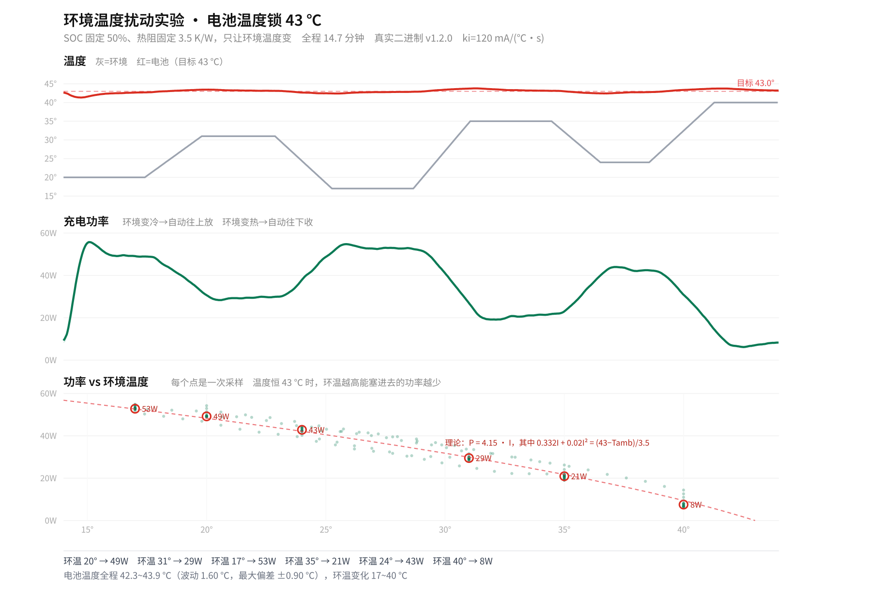
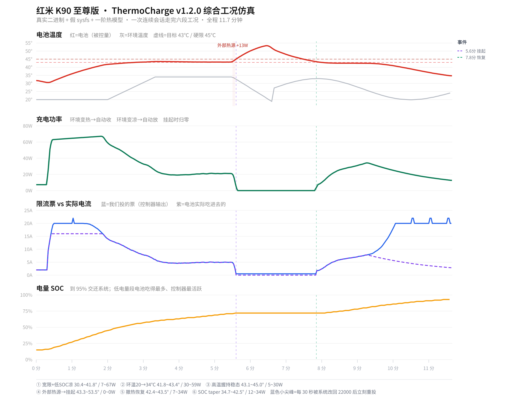

# ThermoCharge 恒温充电模块：内测招募

> **招募对象：** Redmi K90 至尊版（warsaw / M332BF）用户，已安装 KernelSU，愿意按步骤记录充电数据并反馈问题。
>
> **当前版本：** v1.2.0。当前安装包 SHA-256：`9d2e9696e6dfea112f578a83ff7865aac02e3c58d4833445454771f4c4b98c75`。
>
> **重要：** 这是需要共同验证的测试版本，不是稳定版。v1.2.0 目前有仿真和故障注入结果，但还没有完成 v1.2.0 真机充电闭环验证。请先备份重要数据，并确保自己能通过 KernelSU 停用或卸载模块。

## 想解决什么问题？

普通快充通常优先按协议和系统策略尽可能充电，温度升高后再逐步限制。ThermoCharge 尝试反过来做：把电池温度设为目标，按温度反馈调整充电电流，让功率随环境和散热条件变化。

目标不是强行维持某个固定瓦数，而是在安全限制允许的前提下观察：环境变热时功率是否会主动下降；环境变凉时功率是否会回升；电池温度能否接近设定值。

## 目前有什么结果？

### 环境温度扫描仿真



在这组仿真中，SOC 固定为 50%、模型热阻固定，只改变环境温度。使用与 v1.2.0 一致的控制律和默认 `ki=120` 参数，环境从 17 ℃变化到 40 ℃时，模型给出的稳态功率大约从 53 W降到 8 W，电池温度的稳态最大偏差约为 ±0.9 ℃。

这说明了预期的控制方向：环境越热，散热温差越小，可持续充电功率越低。**这不是 K90 至尊版真机实测功率承诺。** 热容、热阻、电池内阻、环境传感器位置和充电协议都会影响真实结果。

### 综合工况仿真



综合仿真覆盖低 SOC 充电、环境升降温、外部热源、硬温度保护挂起与恢复、SOC taper 等情况。外部热源阶段模型温度越过保护阈值后输入挂起；撤掉热源、温度回落后再恢复。这是仿真中的保护路径验证，不代表可以在真机上安全地人为加热测试。

### 当前验证边界

- 闭环仿真使用真实编译二进制和假 sysfs，但电池热模型参数是估算值。
- 10 项故障注入测试通过，覆盖过温优先级、传感器故障、控制通道故障、单实例锁等路径。
- 曾有一段 v1.0.0 真机充电记录，但当时限流票没有成为实际约束，不能用来证明恒温效果。
- **v1.2.0 真机充电闭环尚未验证。** 这正是本次内测最需要确认的部分。

## 内测希望验证什么？

1. 安装、启动、停用和卸载是否正常；未插电时模块是否保持系统节点不变。
2. 从低 SOC 开始充电后，控制器是否确实改变限流票，实际电流是否会受其影响。
3. 在普通室内环境下，温度是否能围绕 43 ℃ 运行，功率是否随温度变化自动调整。
4. 插拔、锁屏、重启、SOC 接近 95%、系统快充策略变化时，状态是否正常交还系统。
5. 日志中是否出现 `sensor_fault`、`ctl_fault`、反复重启、异常挂起等错误。

## 参与条件

- 设备：Redmi K90 至尊版 / warsaw / M332BF；其他机型暂不在支持范围。
- 系统：已安装 KernelSU，能够查看模块状态并在异常时停用/卸载。
- 充电器与线材：使用平时稳定可靠的有线充电器；无线充电未适配。
- 测试环境：先在室温、有人看护的条件下测试，不要放在枕头、被褥、密闭空间或阳光直射处。
- 测试者愿意提供充电区间、设备状态和相关日志；分享前可删除个人路径、账号信息等无关内容。

## 建议测试步骤

1. **先检查版本。** 确认安装包 SHA-256 与本文顶部一致，KernelSU 中模块版本显示 v1.2.0。若显示版本或文件不一致，请先不要开始充电测试。
2. **确认恢复方式。** 记下如何在 KernelSU 中停用/卸载模块。遇到异常升温、充电反复中断、状态不明或设备异常时，立即停止测试并停用模块；不要继续插电观察。
3. **记录基线。** 模块停用时，在相近室温下记录一次普通充电的 SOC、温度、耗时和功率变化，作为对照。
4. **从较低 SOC 测试。** 建议电量约 15–30% 时开始，保持日常使用状态，不要同时运行大型游戏或人为制造热源。先观察 10–15 分钟；确认温度和充电状态正常后，再决定是否继续。
5. **观察曲线。** 记录起始 SOC、结束 SOC、室温大致范围、是否握持/放桌面、温度最高值、功率变化、是否发生挂起，以及系统/模块版本。不要仅看功率，需要同时看电池温度和实际电流。
6. **结束后交还系统。** 拔掉充电器，确认模块状态回到未充电；若出现异常，先停用模块，再导出日志。不要在充电中反复切换参数或同时运行其他限流模块。

建议反馈格式：

```text
机型/系统版本：
模块与安装包版本：
开始/结束 SOC：
室温与摆放方式：
测试时长：
温度范围：
功率/实际电流变化：
是否发生挂起或异常：
模块日志/curve.csv：
```

日志位置通常为 `/data/adb/thermocharge/log/`，包含 `daemon.log` 和 `curve.csv`。分享前请检查并清除无关的设备标识或个人信息。

## 安全说明

本模块会影响充电电流，并在过温保护路径中尝试挂起输入。软件策略不能替代电池、充电器和系统本身的保护，也不能保证在所有内核、ROM、充电器或热环境下行为一致。高温充电会加速电池老化。

- 不要为了测试而加热手机、覆盖手机、边充边玩大型游戏或无人看管充电。
- 发现温度持续上升、超过模块硬限、反复断充、充电异常或设备发烫时，立刻停止测试并停用模块。
- 不要把仿真的 53 W、8 W 或温度曲线当成真机性能保证。
- 目前只针对指定机型和有线充电路径；其他设备、无线充电和不同系统版本未经验证。
- 若不确定风险或无法恢复 KernelSU 模块，请不要安装。

## 一起测

欢迎符合条件的 K90 至尊版用户参与，优先反馈可复现的异常和完整曲线。我们会根据真机数据检查实际控制是否生效，再决定是否调整参数或发布后续版本。在 v1.2.0 真机闭环验证完成前，项目状态仍是**内测中**。
